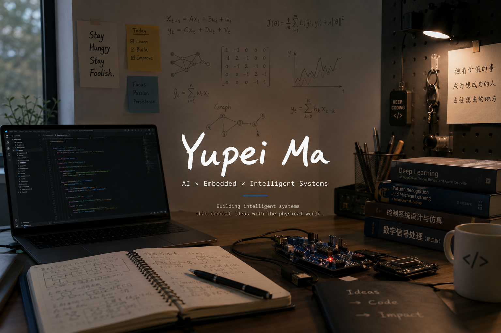

  <b>AI Research · Computer Vision · Visual Perception</b>

  Undergraduate transferring to <b>Information and Communication Engineering</b>

  
  
  
  

---

## About Me

I'm an undergraduate researcher transferring to **Information and Communication Engineering**, with a strong passion for **Artificial Intelligence and Computer Vision**.

My research focuses on visual perception, representation learning and deep learning, aiming to develop robust vision algorithms for image and signal understanding. I’m also interested in efficient model optimization for practical perception systems.

Currently, I'm exploring the intersection of:

👁️ Computer Vision · 🧠 Deep Learning · 📶 Signal Processing · ✨ Visual Representation Learning · ⚡ Efficient Edge AI

  <b>Contact:</b> <a href="mailto:13933838842@163.com">Email</a> · <a href="https://github.com/myp-super">GitHub</a>

  

---

> *"Building robust visual perception models to understand signals and images."*

